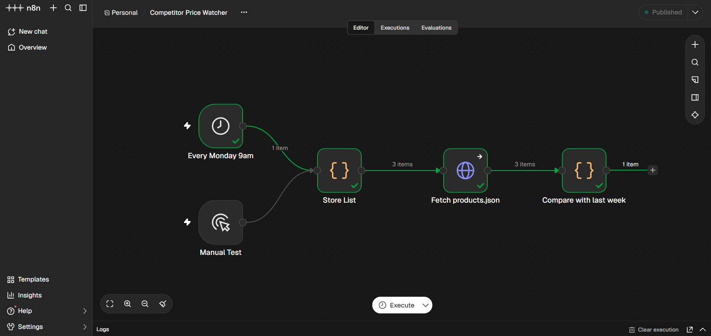
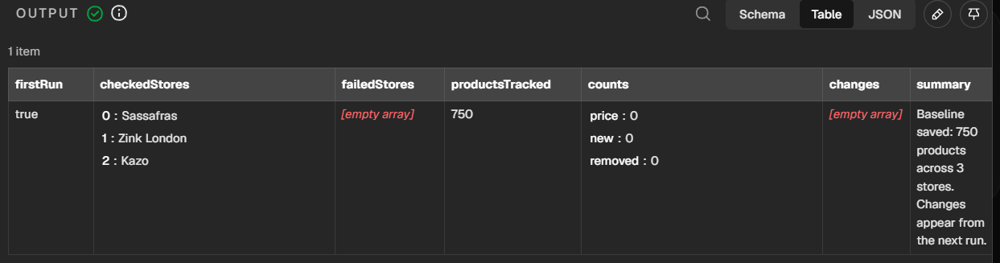

# Competitor Price Watcher (n8n)

A small n8n workflow that checks competitor product catalogues every Monday and reports what changed since last week: price changes, new products and removed products.

Built as a first version of a "competitor watcher": scheduled data pull, change detection, and a check that flags a broken source instead of silently reporting wrong numbers.

## Screenshots

**Workflow canvas**

**First run: baseline saved**

## What it does

1. **Every Monday 9am** (Schedule Trigger) starts the run. A **Manual Test** trigger is there for trying it by hand.
2. **Store List** holds the competitor stores to track.
3. **Fetch products.json** downloads each store's public Shopify catalogue. No HTML scraping.
4. **Compare with last week** (Code node) takes the lowest variant price per product, compares it with last week's saved prices, and builds a plain-text summary.

## Checks built into the compare step

- A store that returns an error or an empty catalogue is flagged as a warning. It is **not** treated as "every product was removed".
- A failed store keeps its last known data, so when it recovers there are no false NEW/GONE alerts.
- The first run only saves a baseline. Changes show from the second run.

## Setup (10 minutes)

1. In n8n: **Workflows > Import from File** and select `Competitor-Price-Watcher.json`.
2. Open the **Store List** node and replace the example stores with 3-5 competitors. Each URL must open in a browser and show JSON. To check a store, add `/products.json` to its home page URL. Shopify stores only.
3. Click **Execute Workflow** on the Manual Test trigger. You should see a "Baseline saved" summary.
4. **Activate** the workflow. Last week's prices are kept in workflow static data, which only persists on active scheduled runs, not on manual test runs.

## Not built yet

- Gemini summary of the changes (send `summary` to a Gemini node with a short prompt).
- Email or Slack delivery of the summary.
- Marketplaces (Myntra, Ajio): they load prices with JavaScript and block bots, so this version covers Shopify stores only.

## Notes

- Keep it to once a week and check each site's robots.txt and terms.
- Prices come from each store's own public catalogue feed.
